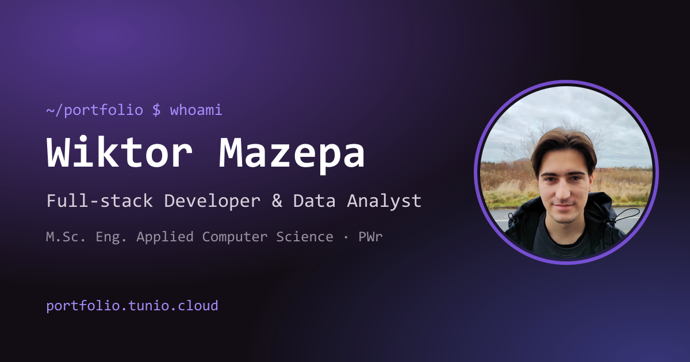

# Wiktor Mazepa – Portfolio

Personal portfolio: **[portfolio.tunio.cloud](https://portfolio.tunio.cloud)**



## Stack

- **React 19 + TypeScript** (strict) on **Vite 8**
- **Tailwind CSS v4** + **[shadcn/ui](https://ui.shadcn.com)** (Radix primitives, `radix-vega` style, violet theme, JetBrains Mono)
- **motion** for animations (`LazyMotion`, respects `prefers-reduced-motion`)
- Docker (Node build → Nginx) deployed by GitHub Actions → GHCR → VPS behind Traefik

## Scripts

```bash
npm ci            # install
npm run dev       # dev server on http://localhost:5173
npm run build     # type-check + production build
npm run lint      # ESLint (typescript-eslint, react-hooks, react-refresh)
npm run preview   # serve the production build
```

## Editing content

All content lives in typed modules – no UI code needs to change to add a project or a job.

| File                         | What it holds                                                  |
| ---------------------------- | -------------------------------------------------------------- |
| `src/data/profile.ts`        | Name, headline, about text, email, socials, CV link, avatar     |
| `src/data/experience.ts`     | Jobs and degrees (timeline)                                    |
| `src/data/projects.ts`       | Project case studies (cover, gallery, stack, architecture)     |
| `src/data/certificates.ts`   | Certificates with credential IDs / verify links                |
| `src/data/tech.ts`           | Technology registry (label, icon, category) used everywhere    |

Technologies are referenced by id (`TechId`), so a typo is a compile error. The skills section is
generated from the registry, and each technology shows where it was used (derived in `src/data/usage.ts`).

**CV:** put `cv.pdf` in `public/` and set `cvUrl: "/cv.pdf"` in `profile.ts` – download buttons appear in the
hero, contact section, mobile menu and the ⌘K palette.

**Animated avatar:** export a short looping MP4, put it in `public/avatar.mp4` and set
`avatarVideo: { mp4: "/avatar.mp4" }` in `profile.ts`. The video is only loaded when the contact section
scrolls into view and is replaced by the static image for reduced-motion users.

## UI components

`src/components/ui` contains generated shadcn/ui components – add more with:

```bash
npx shadcn add <component>
```

Project components are in `src/components` (sections, layout, shared pieces), hooks in `src/hooks`.

## Features

- Typewriter name animation, scroll progress bar, animated background glow
- Command palette (`Ctrl/⌘ + K`) for navigation, projects, links and theme
- Project case studies in a Dialog (desktop) / Drawer (mobile) with gallery, tabs and shareable `?project=` links
- Light / dark / system theme without a flash on load
- Lazy-loaded case-study and command-palette chunks, vendor chunks for long-term caching
- SEO: meta + Open Graph image, JSON-LD `Person`, `robots.txt`, `sitemap.xml`

## Deployment

Every push to `main` runs `.github/workflows/deploy.yml`: build the Docker image → push to GHCR →
SSH into the VPS → `docker compose pull && docker compose up -d`.
